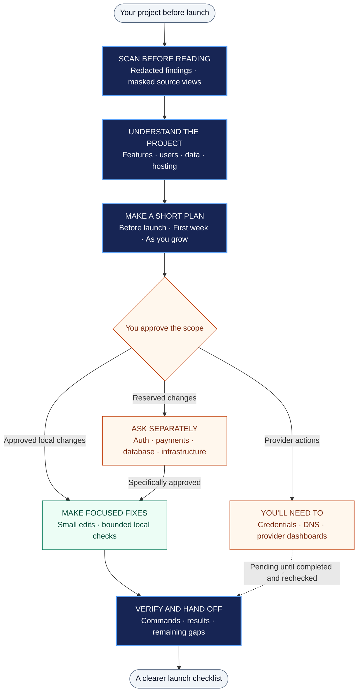

<h1 align="center">secure-launch</h1>

<p align="center"><strong>Know what matters before you go live.</strong></p>

<p align="center">
  <a href="#one-line-install">Install</a> ·
  <a href="#how-it-works">How it works</a> ·
  <a href="#try-it">Try it</a> ·
  <a href="secure-launch/SKILL.md">Skill source</a> ·
  <a href="evals/RESULTS-2026-09-27.md">Evidence</a> ·
  <a href="CHANGELOG.md">Changelog</a>
</p>

Scan before reading. Focus on day-one exposure. Approve the fixes. Show what was verified.

`secure-launch` is a portable Agent Skill for preparing a project for launch. It inspects what you actually use, builds a short security checklist, proposes bounded local changes, and hands provider actions back to you.

Works with Claude Code, Codex, and other harnesses that load `SKILL.md`. Available scanners, test tools, and sandbox permissions depend on the host.

## One-Line Install

```bash
npx skills@latest add AaravKashyap12/secure-launch --skill secure-launch
```

Requires Node.js and npm supported by the current [Skills CLI](https://github.com/vercel-labs/skills). The installer fetches this repository and selects only `secure-launch`. Follow its prompts to choose your agent and installation scope. Add `-g` for a global installation.

Then ask your agent to use `secure-launch` in your project. The bundled scanner uses Python 3's standard library; the skill looks for `python3`, `python`, or `py -3`. It can use an installed gitleaks scanner instead. If neither is available, it asks you to install Python 3 or gitleaks and stops before reading source. Masked source viewing requires Python 3.

## How It Works

One owner interprets the security findings and keeps the work within your approved scope. The plan separates changes the agent can make locally from steps only you can complete.



A typical SaaS gets roughly 12–15 actionable Before-launch groups, fewer when features are absent. That is a presentation target, not a cap that hides real exposure. Inventory and evidence recording are process steps, not extra checklist items.

## Use It When

- You are about to launch a SaaS, API, website, or internal tool.
- You want to check credentials, access boundaries, webhooks, and abuse limits before real users arrive.
- You need to separate immediate fixes from later hardening and provider setup.
- You are preparing an agent skill, MCP server, or package for distribution.

## Try It

```text
Use secure-launch before I launch this project. Scan before reading source,
tailor a short checklist, and propose the files and local checks for each fix.
Wait for my approval before changing anything.
```

```text
Use secure-launch on this SaaS. Prioritize reachable day-one exposure and
separate local changes from the credentials, DNS, and provider steps I own.
```

```text
Use secure-launch to recheck this project after I complete the listed actions.
Focus on changed areas and treat earlier results as historical.
```

## What It Covers

| Area | Conditional checks |
| --- | --- |
| Credentials and data | Secrets in source/client bundles; separate development and production credentials/data |
| Accounts and tenants | Access control, tenant isolation, Supabase/Firebase rules, session boundaries |
| Public endpoints | Auth, AI and write limits; bot-resistant forms; proxy-aware client IP handling |
| Browser and integrations | Baseline headers, debug settings, input handling, safe redirects, webhook verification |
| Deployment handoff | CDN/TLS setup, provider settings and email-domain authentication (SPF/DKIM/DMARC) |
| Other project types | Supply-chain, cloud, desktop, mobile, AI and agent-tool controls selected for actual exposure |

Routine CSP rollout, logging redaction, security contacts, CI pinning, and dependency automation usually belong in **First week**. Kubernetes, provenance, deeper ASVS work, GraphQL complexity, and MCP transport depth normally belong in **As you grow**. A demonstrated day-one exposure can move an item earlier.

## What Stays With You

The agent asks before remediation. A general plan approval does not authorize authentication/session changes, database schemas or RLS, payment changes, infrastructure, CSP enforcement, major dependency updates, or new external services; those need specific approval.

Credential provisioning and rotation, DNS, provider dashboards, live storage permissions, and legal decisions remain user actions. The skill does not deploy, scan production, or automatically install scanners. A credential-shaped example gets a proposed placeholder replacement and a reminder to rotate it if it was ever real.

Every item distinguishes **Already in place**, **I'll add this**, **You'll need to**, and **Not needed because** from the evidence state. An unavailable check stays unverified.

## Other Install Methods

Install globally for a specific host:

**Claude Code**

```bash
npx skills@latest add AaravKashyap12/secure-launch --skill secure-launch --agent claude-code --global
```

**Codex**

```bash
npx skills@latest add AaravKashyap12/secure-launch --skill secure-launch --agent codex --global
```

To list the skill without installing:

```bash
npx skills@latest add AaravKashyap12/secure-launch --list
```

Or copy the complete `secure-launch/` folder from a local clone, including `references/` and `scripts/`:

| Harness | Destination |
| --- | --- |
| Claude Code | `~/.claude/skills/secure-launch/` |
| Codex | `~/.codex/skills/secure-launch/` |
| Other compatible agents | The directory their skill loader scans |

Compare customized installations before replacing them. Start a new task/session if your agent has not discovered the skill.

## Pairing With Engineering Workflows

[Lean Engineering](https://github.com/AaravKashyap12/lean-engineering) governs ownership and small changes backed by checks. [Efficiency Skill](https://github.com/AaravKashyap12/efficiency-skill) helps decide whether bounded delegation is worthwhile. Secure Launch retains security interpretation, approval boundaries, and the final evidence assessment with the owner. It works without either companion skill; no reviewer swarms are required.

## Source of Truth

[secure-launch/SKILL.md](secure-launch/SKILL.md) is the canonical workflow. [agents/openai.yaml](secure-launch/agents/openai.yaml) supplies optional Codex display metadata. The README explains installation and usage without adding a second workflow.

[Research](RESEARCH.md), [coverage](COVERAGE-MATRIX.md), and [runtime sources](secure-launch/references/sources.md) record the basis and scope of the guidance. Installing this skill does not authorize external changes or override the host's higher-priority instructions.

## Validation and Limitations

This is a launch-readiness pass, **not a penetration test or a compliance certificate**. Local checks cannot prove production DNS, TLS, storage policies, or provider settings. No automated checklist proves an app secure. Pattern scans can miss unknown secrets and flag harmless placeholders; masked views only cover recognized patterns and explicitly flagged lines.

**Mobile coverage is a starter set, not full MASVS coverage or verification.** Specialist review and platform tooling may still be needed.

**The Express SaaS case (login rate limit and webhook signature fix) has discovery-only evidence because Codex's Windows sandbox blocks Node test workers. Those fixes have not been verified.**

The original four Codex trials recorded **1 PASS, 2 PARTIAL, 1 BLOCKED**. The authorized Express rerun remained BLOCKED; its synthetic-marker output violation is recorded separately. Later owner checks passed for the changed Next.js build/client bundle and package tests, without promoting historical actor outcomes.

The 0.1.2 scanner check passed 53 generated cases, including masked output and line preservation. Version 0.1.3 changed interpreter discovery instructions; no new behavioral trials were run. Scan-before-read agent adherence and gitleaks integration remain unverified. See [results](evals/RESULTS-2026-09-27.md), [owner checks](evals/FIXTURE-CHECKS.md), and the [evaluation protocol](evals/README.md). These are recorded results, not comparative or production-safety claims.

## Repository Layout

```text
secure-launch/
  SKILL.md                 Canonical launch workflow
  agents/openai.yaml       Optional Codex display metadata
  references/              Profiles, controls, stack pointers and source records
  scripts/redacted_scan.py Local scanner and masked source view
evals/                     Synthetic fixtures, checks and recorded evidence
RESEARCH.md                Research and scope
COVERAGE-MATRIX.md          Control coverage
CHANGELOG.md               Release history
LICENSE                    MIT license
```

## Contributing

Open an issue or pull request with a concrete failure case, the affected project type, the proposed instruction change, and a focused check. Cite primary sources for security guidance. Use synthetic fixtures and redacted evidence; never include real credentials or private customer data.

## License

[MIT](LICENSE) · Built by [Aarav Kashyap](https://github.com/AaravKashyap12).
